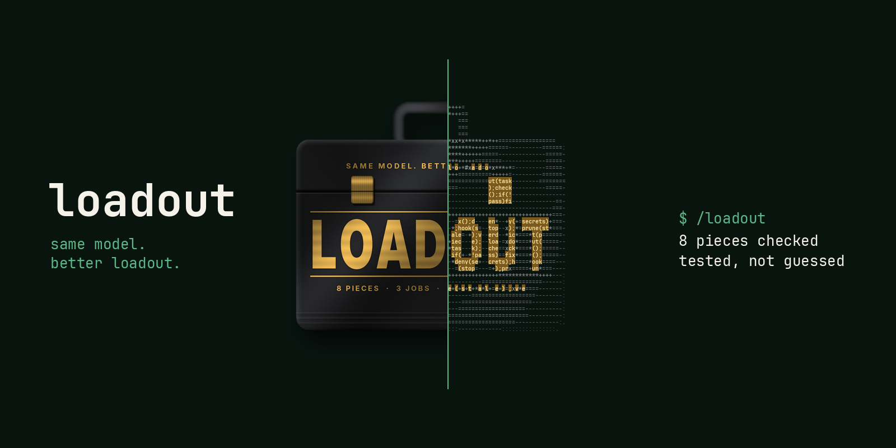

<p align="center"></p>

# Loadout

**Same model. Better loadout.** A Claude skill that fits Claude Code's harness to your project and the task you are
about to do. It checks which of the eight pieces you're missing, builds the ones your task needs, cuts what is bloated
or stale, and tests everything it touches.

By [@murphmaxxing](https://www.instagram.com/murphmaxxing/).

## What a harness is

Everything around the model. In Claude Code that is eight pieces doing three jobs:

| Job | Pieces |
|---|---|
| What Claude knows | `CLAUDE.md`, rules, skills |
| What Claude can do | commands, subagents, MCP servers |
| What keeps it in check | settings (permissions, sandbox), hooks |

A study of 2,853 open-source repositories found a context file such as `CLAUDE.md` in 90.6% of them, and for Claude
Code no other piece in more than one in five ([Galster et al., 2026](https://arxiv.org/abs/2602.14690)). Most
projects have one piece of a harness.

## What it does

1. **Understands the task.** What you are doing here for the next few weeks, what Claude has got wrong before, and
   how you know when work is right.
2. **Takes stock.** A bundled script lists your eight pieces and finds real faults: a settings file that is not
   valid JSON (Claude Code skips the whole file), misspelled fields that are silently ignored, hooks that point at
   scripts that do not exist, commands in your `CLAUDE.md` that cannot run.
3. **Builds the check first.** Something Claude can run that comes back pass or fail, held as strictly as your task
   needs: a line in `CLAUDE.md`, a `verify` skill, a hook that will not let Claude stop until the check passes, or
   a reviewer that can read but not edit.
4. **Gives each of the eight a verdict** for your task: build, tune, keep, cut or skip, with the reason.
5. **Shows you the plan** and changes nothing until you say go.
6. **Tests what it built.** Fires each hook, runs each check, tries each deny rule on a dummy file.
7. **Writes `.claude/HARNESS.md`**: why each piece is there and when to remove it.

Afterwards, `/loadout fix <what went wrong>` turns a mistake into the smallest change that stops it happening again,
and `/loadout prune` removes what a newer model no longer needs.

## Why it does not just install everything

Because the evidence says that makes things worse.

- Context files written by a model did not raise success and cost over 20% more; the authors "suggest omitting
  LLM-generated context files" ([ETH Zurich, arXiv 2602.11988](https://arxiv.org/abs/2602.11988)).
- Skills a model wrote for itself scored 8 to 11 points below having no skills. Compact skills gained +19 points,
  comprehensive ones +0.7 ([SkillsBench, arXiv 2602.12670](https://arxiv.org/abs/2602.12670)).
- What did help in a component-by-component test: a memory of real lessons, better tools, and a check before
  finishing. Instructions alone made it slightly worse ([AHE, arXiv 2604.25850](https://arxiv.org/abs/2604.25850)).

So the skill writes down only what Claude could not find by reading your project, asks you for the facts only you
have, and puts its effort into checks and enforcement. The full list of what has and has not been measured is in
[`references/evidence.md`](references/evidence.md).

## Install

Claude Code, for every project on your machine:

```bash
git clone https://github.com/murphyaidanbusiness-ux/loadout ~/.claude/skills/loadout
```

For one project, clone it into `.claude/skills/loadout` inside that project instead.

## Use

Open Claude Code in your project and say what you are about to do:

```
/loadout I'm adding Stripe subscriptions to this app
/loadout I write my weekly newsletter in this folder and Claude keeps making up statistics
/loadout audit
/loadout fix Claude said the feature worked and it didn't
/loadout prune
```

It reads first. It changes nothing until you approve the plan, and it never touches your global `~/.claude` setup
without asking. Claude Code will ask before it writes into your project's `.claude` folder; that prompt is expected.

## How it was tested

On four sample projects, the same request was run with the skill and without it (Claude Sonnet 5.5, one run each),
and graded by a script plus a separate grader. Details: [`evals/RESULTS.md`](evals/RESULTS.md).

- **First round: a tie.** 34 of 37 checks with the skill, 33 of 37 without. Claude is already good at tidying a
  bloated `CLAUDE.md` and writing sensible permissions.
- **Second round: 44 of 46 with the skill, 37 of 46 without**, after the checklist was extended and the skill
  tightened. This round is not blind: the same four projects were used for both.
- **Where the skill made the difference:** it ran what it built (fired the hooks, ran the scripts, tried the deny
  rule), it enforced the failure the user named with a hook instead of a sentence, and it left a record of why.
- **It costs more:** about twice the time and tokens of just asking.
- **Not measured:** whether Claude then does your actual task better. That takes real use.

## What it is not

- A promise that Claude gets smarter. The model sets the ceiling; a harness decides how close you get. The skill
  reports what it built and tested and says what is only reasoning.
- A template. Two projects, or two tasks in one project, get different harnesses.
- Finished when it runs. A harness is finished by use: every mistake Claude makes is a reason to change it.

Checked against the Claude Code docs on 2026-11-23 (Claude Code 2.1.331). Claude Code changes often; the skill
tells Claude to re-read the docs page when a field or command fails.

## Licence

MIT.
